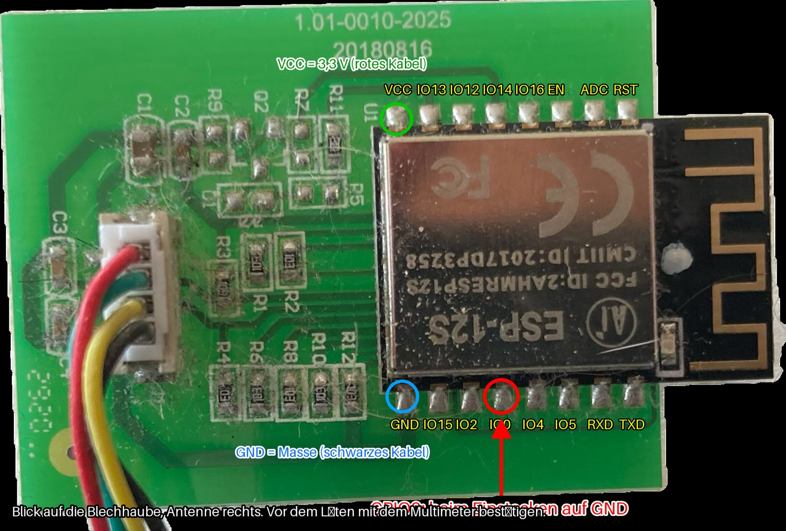

# Tesvor X500 / X500 Pro ohne Cloud: ESPHome, MQTT-Karte und Home Assistant

Der Tesvor X500 Pro ist ein günstiger Saugroboter mit Gyro-Navigation, der nur über die
WeBack-Cloud bedienbar ist. Funktioniert die App-Kopplung nicht mehr, ist das Gerät wertlos.
Dieses Repository macht ihn **komplett lokal** nutzbar: Das WLAN-Modul des Roboters bekommt
ESPHome, Home Assistant bekommt eine echte `vacuum`-Entität mit Karte, alles ohne Cloud.

Grundlage ist die Protokoll-Arbeit von
[hannes813/tesvor-x500-pro-esphome-vacuum](https://github.com/hannes813/tesvor-x500-pro-esphome-vacuum)
(MIT). Dieses Repository bündelt darauf aufbauend die komplette Inbetriebnahme, wie sie bei mir
seit Oktober 2026 läuft: drei Firmware-Varianten (Originalmodul, ESP32, ESP32-S3), ein
Docker-Container für die Karte, die Home-Assistant-Vorlagen und die Erkenntnisse aus dem Umbau.



## Was funktioniert

| Funktion | Stand |
|---|---|
| Start Smart / Spot / Kanten, Stopp, zur Ladestation, Richtungstasten | bestätigt |
| Zickzack-Wischen, Wischintensität | bestätigt |
| Zustand (reinigt, lädt, in der Station, Störung …), Fehlertext, Akkustand | bestätigt |
| Fahrroute als Karte im Dashboard, Archiv je Fahrt | bestätigt |
| `vacuum.tesvor_x500_pro` in Home Assistant (Start, Pause, Stopp, zurück, Spot, Saugstufe) | bestätigt |
| Saugstärke | **wirkungslos**: Befehle werden quittiert, aber der Lüfter ändert sich nicht (Hörtest 27.10.2026); Entität nur für Versuche, nicht in der vacuum-Entität |
| „Mop Cleaning" | experimentell (wie upstream) |

Die Karte ist eine gefahrene Route aus Gyro-Punkten, keine Raumkarte. Mehr liefert die
Roboterplatine nicht.

## Aufbau

```
Roboter-Hauptplatine ──UART 115200──► ESP (ESPHome) ──WLAN──► MQTT-Broker ──► tesvor-map (Docker)
                                            │                                      │
                                            └── ESPHome-API ──► Home Assistant ◄───┘ (www/tesvor-map)
```

- `esphome/` – Firmware. `tesvor-x500-esp32s3.yaml` ist die empfohlene Variante (ESP32-S3-Board
  statt Originalmodul). `tesvor-x500-esp8266.yaml` läuft auf dem originalen ESP-12S,
  `tesvor-x500-esp32.yaml` auf einem NodeMCU-ESP32. Parser und Entitäten sind in allen dreien gleich.
- `docker/tesvor-map/` – Container, der die MQTT-Pfadpunkte in `current.json` und Archive schreibt.
- `homeassistant/` – Template-`vacuum`, deutsche Klartext-Sensoren, Start-Skript, Dashboard-Sektion.
- `docs/` – Hardware, Flashen, Protokoll, Betrieb und Fallen.
- `tools/` – Kommandozeilen-Helfer für das ESPHome-Dashboard (WebSocket) und ein MQTT-Rohlog.

## Schnellstart

1. **Hardware** nach [docs/hardware.md](docs/hardware.md): Originalmodul flashen oder durch ein
   ESP32-S3-Board ersetzen (empfohlen). Vier Leitungen: 3,3 V, GND, TX, RX.
2. **Firmware**: Variante aus `esphome/` ins ESPHome-Dashboard laden, `secrets.yaml` nach
   `esphome/secrets.yaml.example` anlegen, kompilieren, flashen ([docs/flashen.md](docs/flashen.md)).
3. **Karte**: `docker/tesvor-map/` mit `.env` starten, Ziel ist der `www/tesvor-map`-Ordner von
   Home Assistant; `app/map.html` dorthin kopieren.
4. **Home Assistant**: ESPHome-Gerät mit dem API-Schlüssel anlegen, Dateien aus `homeassistant/`
   übernehmen ([homeassistant/README.md](homeassistant/README.md)).

Betriebserfahrungen, bekannte Fallen und das Protokoll: [docs/betrieb.md](docs/betrieb.md),
[docs/protokoll.md](docs/protokoll.md).

## Mehrere Roboter

Alles ist auf mehrere Geräte ausgelegt, ohne dass sich etwas in die Quere kommt:

- **Firmware:** Je Roboter eine Kopie der YAML mit eigenen `substitutions` (`name`,
  `friendly_name`, `topic_prefix`, z. B. `tesvor-x500-2`, „Tesvor Keller", `tesvor/x500-2`).
  Daraus folgen eindeutige Hostnamen, MQTT-Themen und Entitäts-IDs in Home Assistant.
- **Karten-Writer:** Ein Container für alle. Er abonniert `<TOPIC_ROOT>/+/…`, erkennt das Gerät am
  Präfix und schreibt je Gerät einen Ordner (`x500/`, `x500-2/`, …) plus `devices.json`.
- **Kartenseite:** Zeigt bei mehr als einem Gerät eine Geräteauswahl; `?device=x500-2` an der
  iframe-URL wählt vor. Anzeigenamen kommen aus `DEVICE_NAMES` in der `.env`.
- **Home Assistant:** Das Start-Skript leitet das Gerät aus der übergebenen Taste ab und gilt für
  alle Roboter. Die Template-`vacuum` und die Dashboard-Sektion werden je Gerät kopiert und auf
  die jeweiligen Entitäts-IDs angepasst (siehe `homeassistant/README.md`).

## Sicherheit

- Firmware-Binärdateien gehören nicht ins Repository: Sie enthalten WLAN-Zugangsdaten und den
  API-Schlüssel. `.gitignore` schließt sie aus.
- Vor dem Flashen des Originalmoduls ein 4-MB-Backup ziehen. Damit ist der Rückweg zur
  WeBack-Firmware jederzeit möglich.
- Nie 5 V an das Modul oder die Roboterleitungen. Beim Flashen am PC die 3,3-V-Leitung vom
  Roboter abklemmen.

## Lizenz und Dank

Eigene Teile: MIT ([LICENSE](LICENSE)). Parser-Lambda, Protokoll, Karten-Writer und Kartenseite
stammen von hannes813 (MIT, [LICENSE-upstream](LICENSE-upstream)) und wurden hier angepasst und
erweitert (Zustand 0x07, deutsche Optionen, umschaltbarer Logger, Archiv-Begrenzung).
Reverse Engineering und Flashen auf eigene Gefahr.
