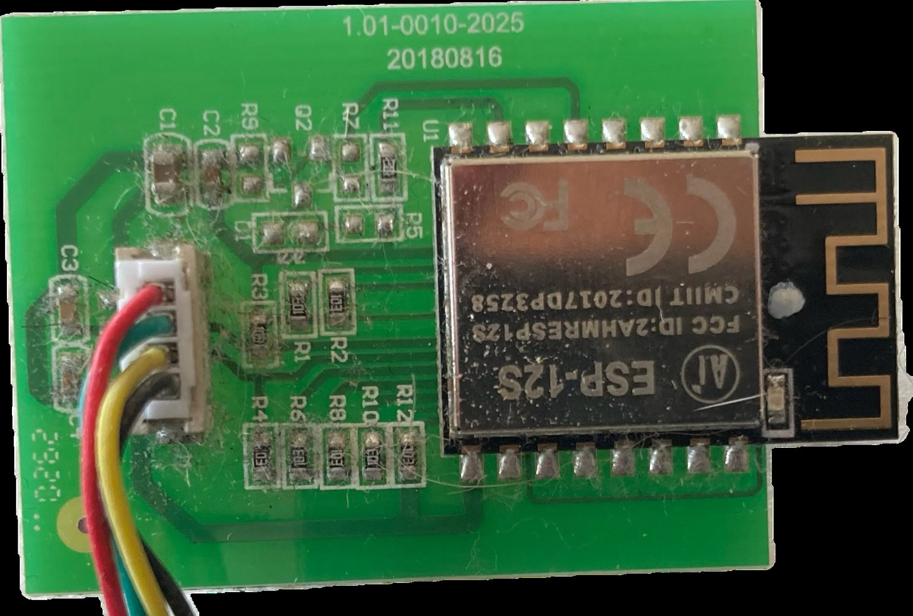
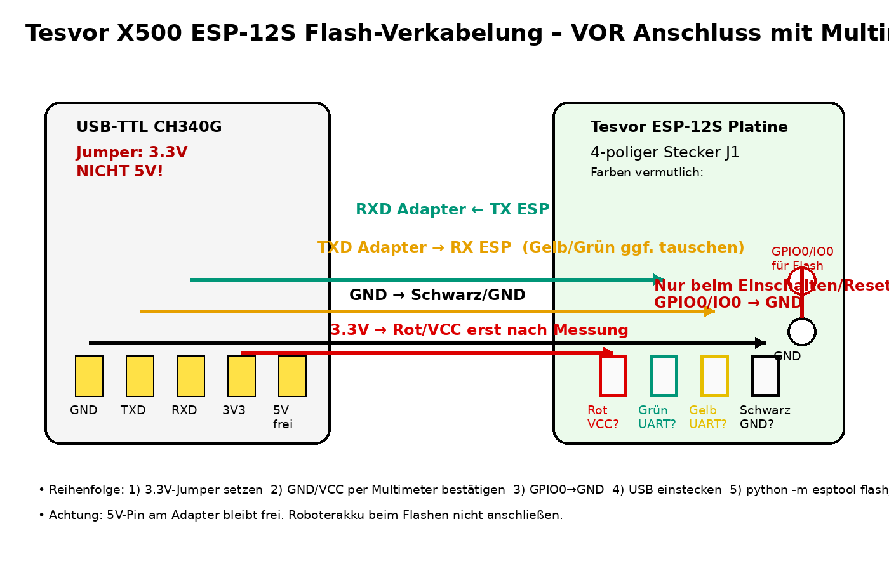

# Hardware

## Was im Roboter steckt

Die WLAN-Anbindung des Tesvor X500 Pro ist ein steckbares Modul: eine kleine Trägerplatine
(bei mir „1.01-0010-2025 / 20180816") mit einem **Ai-Thinker ESP-12S** (ESP8266, 4 MB Flash) und
einem vierpoligen Stecker zur Hauptplatine. Die Hauptplatine spricht mit dem Modul über UART
mit 115200 Baud; das Protokoll steht in [protokoll.md](protokoll.md).

Die vier Leitungen (Farben bei meinem Gerät, bei anderen Chargen gegebenenfalls anders):

| Kabel | Funktion |
|---|---|
| Rot | 3,3 V von der Hauptplatine |
| Schwarz | GND |
| Grün | Roboter-TX (Daten zum ESP) |
| Gelb | Roboter-RX (Befehle vom ESP) |

Welche der beiden mittleren Adern TX und welche RX ist, zeigt der erste Versuch: Kommen
innerhalb von 30 s nach dem Einschalten Statusrahmen `AA 1C 06 …` im Log an, stimmt die
Zuordnung, sonst tauschen. Beide führen nur 3,3-V-Signale, Vertauschen schadet nicht.

## Weg A: Originalmodul flashen (`tesvor-x500-esp8266.yaml`)

Das ESP-12S lässt sich direkt mit ESPHome flashen. Pinbelegung mit Antenne nach rechts, Blick
auf die Blechhaube:

| Reihe | von links nach rechts |
|---|---|
| oben | VCC, IO13, IO12, IO14, IO16, EN, ADC, RST |
| unten | GND, IO15, IO2, **IO0**, IO4, IO5, RXD, TXD |

Zum Flashen muss **GPIO0 beim Einschalten auf GND** liegen. Der Pin ist der vierte von links
in der unteren Reihe; bequemer ist der obere Lötpad des 10-kΩ-Widerstands direkt darunter
(Durchgang zum Pin vorher prüfen). Die seriellen Leitungen und 3,3 V kommen über den Stecker.

Reihenfolge: Jumper am Adapter auf 3,3 V, GND und VCC mit dem Multimeter bestätigen, GPIO0 auf
GND, dann USB einstecken. Der Roboterakku bleibt dabei abgesteckt. **Nie 5 V.**

Nachteile dieses Wegs: Die einzige Hardware-UART des ESP8266 gehört dem Roboter, es gibt also
keine serielle Konsole, und das Modul hat wenig RAM. Bei mir war außerdem der WLAN-Empfang des
Moduls im Gehäuse unzuverlässig. Deshalb Weg B.

## Weg B: ESP32-S3-Board statt Originalmodul (`tesvor-x500-esp32s3.yaml`, empfohlen)

Die Trägerplatine wird komplett ausgebaut, das vierpolige Kabel kommt an ein ESP32-S3-DevKitC-1
oder ein kompatibles Board (bei mir eines mit zwei USB-Buchsen „UART" und „USB").

| Kabel | ESP32-S3-Pin | Funktion |
|---|---|---|
| Rot | 3V3 | 3,3 V vom Roboter, beim Flashen am PC abklemmen |
| Schwarz | GND | Masse |
| Grün | GPIO16 | Roboter-TX → ESP RX |
| Gelb | GPIO17 | Roboter-RX ← ESP TX |

Vorteile: USB frei zum Flashen und für Logs, keine GPIO0-Brücke, mehr RAM (Kartenpuffer 400
Punkte), stabile Antenne. Das Board braucht einen Platz im Gehäuse mit der Antenne weg von
Metall und Akku. Dupont-Steckverbindungen sichern (Kleber, Kabelbinder oder löten): Ein
Wackelkontakt an der Sendeleitung hat bei mir nach einigen Fahrten mit Anstoßen dazu geführt,
dass Befehle nicht mehr ankamen (Diagnose in [betrieb.md](betrieb.md)).

Boards mit nur einer USB-C-Buchse direkt am Chip brauchen unter `logger:` die Zeile
`hardware_uart: USB_SERIAL_JTAG` (in der YAML vorbereitet). Erstes Flashen: BOOT halten,
RESET tippen, dann Upload.

## Weg C: NodeMCU-ESP32 (`tesvor-x500-esp32.yaml`)

Gleiche Verdrahtung wie Weg B (UART2 auf GPIO16/17), Board `esp32dev`. Konfiguration ist
validiert, aber im Gegensatz zu Weg B nicht im Roboter gelaufen.
